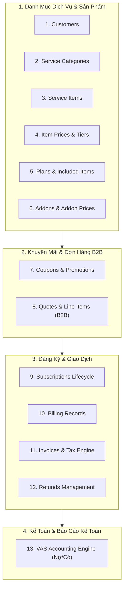

# 🗺️ Bản Đồ Toàn Diện 13 Module Thuộc Hệ Thống Billing (`customer_id`)

Dưới đây là danh sách đầy đủ toàn bộ **13 Sub-modules** của hệ thống Billing được phân chia chuẩn theo **Clean Architecture** (Domain $\rightarrow$ Usecase/Service $\rightarrow$ Delivery API Routes):

---

## 🏗️ 13 Sub-Modules Thuộc Hệ Thống Billing & VAS Accounting

| # | Sub-Module | Chức Năng Chính (Core Features) | Entities / DTOs Chính |
| :--- | :--- | :--- | :--- |
| **1** | **Customers** | Quản lý thông tin khách hàng, thông tin doanh nghiệp, mã số thuế | `Customer`, `CustomerProfile` |
| **2** | **Service Categories** | Danh mục dịch vụ cấp cao (Storage, Bandwidth, Support, Interface) | `ServiceCategory`, `CreateServiceCategoryDTO` |
| **3** | **Service Items** | Mặt hàng/tính năng chi tiết (`item_type`: plan, addon, one_time, usage) | `ServiceItem`, `CreateServiceItemDTO` |
| **4** | **Item Prices & Tiers** | Bảng giá đơn lẻ & lũy tiến bậc thang theo số lượng & chu kỳ | `ItemPrice`, `PriceTier`, `CreateAddonPriceDTO` |
| **5** | **Plans & Included Items** | Đóng gói tính năng thành gói cước (`STARTER`, `PRO`, `ENTERPRISE`) | `Plan`, `PlanIncludedItem`, `CreatePlanDTO` |
| **6** | **Addons & Addon Prices** | Dịch vụ mua thêm ngoài gói (Extra seat, Extra storage, IP dedicated) | `Addon`, `AddonPrice`, `SubscriptionAddon` |
| **7** | **Coupons & Promotions** | Mã giảm giá, khuyến mãi (% hoặc tiền cố định, giới hạn lượt dùng) | `Coupon`, `CouponCode`, `CouponRedemption` |
| **8** | **Quotes & Line Items** | Báo giá tùy chỉnh dành cho doanh nghiệp (Enterprise B2B Quote) | `Quote`, `QuoteLineItem`, `CreateQuoteDTO` |
| **9** | **Subscriptions** | Quản lý vòng đời đăng ký dịch vụ của `customer_id` (Trial $\rightarrow$ Active) | `Subscription`, `SubscriptionLog`, `Provision` |
| **10**| **Billing Records** | Ghi nhận giao dịch thu tiền, hoàn tiền, báo nợ | `BillingRecord`, `CreateBillingRecordDTO` |
| **11**| **Invoices & Items** | Phát hành Hóa đơn GTGT (VAT), tính thuế (`tax_rate_bps`), xuất PDF | `Invoice`, `BillingLineItem`, `InvoicePeriod` |
| **12**| **Refunds** | Quản lý hoàn tiền cho khách hàng khi hủy dịch vụ | `Refund`, `CreateRefundDTO` |
| **13**| **VAS Accounting Engine**| Bút toán Nợ/Có kép, Hệ thống tài khoản VAS, Sổ cái, Tuổi nợ | `JournalEntry`, `ChartOfAccount`, `GeneralLedger` |

---

## 🔄 Tiến Trình Xây Dựng Từ Đầu Đến Cuối (Full Execution Order)



---

## 🛠️ Cấu Trúc File Chi Tiết Theo Clean Architecture

```
billing/src/
├── types/billing/                        # DOMAIN LAYER
│   ├── responses.ts                      # Full TypeScript Interfaces
│   ├── dto.ts                            # Zod Schemas & DTO Types
│   ├── accounting.ts                     # VAS Accounting Interfaces
│   └── analytics.ts                      # Reporting & Financial Metrics
│
├── modules/                              # APPLICATION & SERVICE LAYER
│   ├── catalog/service/catalog.service.ts
│   ├── addon/service/addon.service.ts
│   ├── coupon/service/coupon.service.ts
│   ├── quote/service/quote.service.ts
│   ├── subscription/service/subscription.service.ts
│   ├── invoice/service/invoice.service.ts
│   └── accounting/service/accounting.service.ts
│
└── app/api/v1/                           # DELIVERY LAYER (Next.js REST Routes)
    ├── catalog/
    │   ├── categories/route.ts
    │   ├── items/route.ts
    │   └── plans/route.ts
    ├── addons/route.ts
    ├── coupons/route.ts
    ├── quotes/route.ts
    ├── subscriptions/route.ts
    ├── invoices/route.ts
    └── accounting/
        ├── journal-entries/route.ts
        └── chart-of-accounts/route.ts
```
